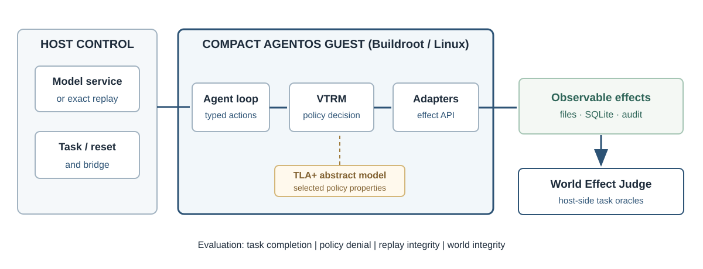
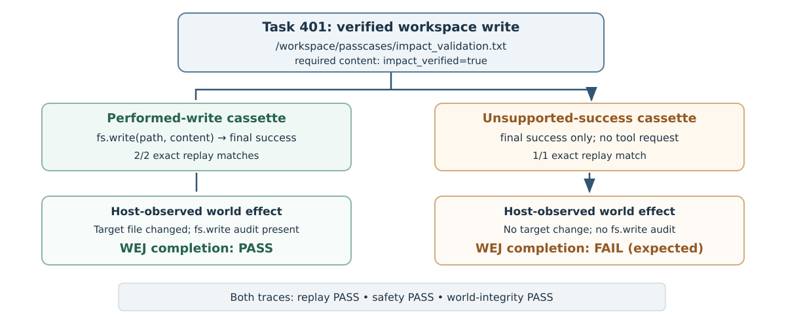

# AgentOS-RK: A Compact and Auditable Research Kit for LLM-Agent Execution

**Article type:** *Software Impacts*, Original Software Publication.

**Authors:** Jun Zhou¹,*; Li Yuan¹,*

¹ Chongqing Electric Power College, Chongqing, Chongqing, China.

*Co-corresponding authors:* Li Yuan (yuanli@cqepc.edu.cn) and Jun Zhou (zhoujun@cqepc.edu.cn). Jun Zhou is the first author. For the submission system, designate Li Yuan as the primary administrative corresponding author if only one contact is supported; indicate both co-corresponding authors on the manuscript subject to journal policy.

## Abstract

AgentOS-RK is a reproducible research kit for studying tool-using large language model agents. Built on the previously published AgentOS runtime, it combines a compact Buildroot guest, typed effect mediation, an abstract TLA+ policy model, and a host-side judge that checks observed state changes instead of agent claims. Researchers can replay recorded interactions without model APIs, add task-specific effect oracles, or evaluate local models. In controlled x86-64 QEMU tests, all 90 selected replay cases passed across 128–512 MiB configured guest RAM; the emulated host environment used substantially more memory. The kit supports reproducible investigations of task utility and policy enforcement.

**Keywords:** LLM agents; research software; typed tool mediation; world-effect evaluation; reproducibility; constrained execution.

## Code metadata

| Nr. | Code metadata description | Value |
| --- | --- | --- |
| C1 | Current code version | AgentOS-RK v0.1.0 release-candidate source snapshot; Git revision `3b69c107da46881e397f95e8305d57a3d2101822`. |
| C2 | Permanent link to code/repository for this version | [Exact source revision](https://github.com/zhoujune/AgentOS-Software-Impacts/tree/3b69c107da46881e397f95e8305d57a3d2101822). |
| C3 | Permanent link to reproducible capsule | No separate computational capsule; exact source and reproducible tests are available through C2 and C8. |
| C4 | Legal code license | MIT for first-party source; Copyright (c) 2026 Jun Zhou. Third-party packages retain their respective licenses. |
| C5 | Code versioning system | Git; pinned upstream source commit and SHA-256-checked journal patch inputs. |
| C6 | Software languages, tools and services | Python 3, Bash, Buildroot/Linux, QEMU x86-64, SQLite, TLA+ (abstract model); optional local LLM service. |
| C7 | Compilation requirements, operating environment and dependencies | Linux x86-64, Git, Python 3, QEMU x86-64, e2fsprogs (debugfs/e2fsck); full guest rebuilding additionally requires compatible Buildroot sources. |
| C8 | Developer documentation | [Reproduction instructions at the exact source revision](https://github.com/zhoujune/AgentOS-Software-Impacts/blob/3b69c107da46881e397f95e8305d57a3d2101822/README.md). |
| C9 | Support email | zhoujun@cqepc.edu.cn |

## 1. Introduction and motivation

LLM agents use tools to move beyond textual generation: they may create files, update database rows, or transmit information to external services. An agent's statement that it has completed a task, however, does not establish that the intended state change occurred. Conversely, a failed task may indicate an absent tool call, a policy denial, an invalid request, or an error in the task's success predicate. Reproducible agent research therefore benefits from a controlled execution environment and an evaluator that inspects effects independently of an agent's final answer.

AgentOS introduced a typed, policy-mediated execution model, a World Effect Judge (WEJ), and an abstract TLA+ specification in the authors' earlier ASE publication [1]. **AgentOS-RK** (AgentOS Research Kit) organizes the resulting software into a reproducible research package. The kit brings together a verified source-reconstruction procedure, deterministic replay fixtures, task-specific effect oracles, audit reports, local-model drivers, and executable examples. Researchers can use it to design new agent tasks, study tool-use decisions, and compare system behavior across repeatable runs.

AgentOS-RK contributes a documented workflow from task definition through constrained execution to effect-based evaluation. By recording both tool interactions and observed state changes, it supports independent inspection of task results and systematic regression testing of the execution stack.

## 2. Software description

### 2.1. Execution boundary and typed effects

Figure 1 outlines the two sides of the system. On the host, task control, VM reset, and a model or exact-replay service orchestrate execution. The agent loop runs inside a compact Buildroot-based Linux guest and emits structured requests for actions such as \`fs.write\` or constrained SQLite operations. Each request identifies its task and operation, supplies typed arguments, and carries policy-related fields such as a subject, a content label, and a required capability. A request to write a workspace file, for example, can declare \`capability_required: fs.write.workspace\`.

The Verified Toolchain Reference Monitor (VTRM) checks each operation against derived capabilities, object and sink rules, and confidentiality labels before the adapter changes state. Its decisions distinguish automatically permitted operations, approval-gated operations, and denials; guest audit records retain enforcement evidence. The research kit exposes these decisions to its replay harness and result validator. A companion TLA+ specification models selected abstract properties of policy mediation, including denial with no resulting effect [1].

*Fig. 1. AgentOS-RK execution and evaluation architecture. Model inference or deterministic replay is controlled on the host; typed operations pass through VTRM in the Buildroot guest; WEJ inspects observed results. Schematic prepared with OpenAI ChatGPT assistance.*

### 2.2. World-effect judging and output evidence

The host-side WEJ evaluates a task against its declared success and safety predicates using observable artifacts. Depending on the task, these can include before/after filesystem snapshots, specified file contents, SQLite state, permission-denial events, and configured network-related records. **Task completion and policy enforcement are separate outcomes**: a requested protected mutation may be correctly denied even when the requested task is not completed. Similarly, replay consistency and world integrity can pass while completion fails because an agent only claimed success.

The evaluation driver emits machine-readable records containing task identifiers, completion predicates, world-integrity results, safety checks, replay-request counts and matches, and relevant audit events. A researcher can inspect these separate fields to locate failures in request generation, authorization, execution, or outcome evaluation. The reports also include the evidence needed to repeat comparisons with revised tasks or software versions.

### 2.3. Packaging, configuration and repeatability

AgentOS-RK offers a single-checkout workflow for reconstructing the pinned AgentOS revision with seven SHA-256-verified journal-source inputs, preparing an offline evaluation image, and launching repeatable QEMU cases. Experiments use separate disposable filesystem copies and output directories; the source image is not overwritten. In the deterministic mode, a response cassette supplies fixed model-side messages, so no model API credentials or GPU are necessary. This isolates regressions in the bridge, policy decision, effect adapter, or judge from changes in LLM generation.

Task definitions specify an instruction and explicit `expected` predicates; replay cassettes bind each response to a task and step identifier. The repository provides the reconstruction script, a six-case representative test suite, a two-trace reuse example, and a fail-closed result validator [3]. The prepared evaluation inputs include a roughly 6.0 MB kernel and a 60 MiB provisioned ext2 image, allowing test environments to be constructed from compact stored artifacts.

In preparing portions of the research-kit packaging and evaluation scripts, OpenAI ChatGPT was used for coding and testing assistance. Those scripts are accompanied by automated regression checks and source-provenance records; the authors remain responsible for reviewing their behavior and verifying the reported research results.

## 3. Illustrative use: one task, two claims of success

The bundled task \`401-world-effect-reuse\` asks the agent to create \`/workspace/passcases/impact_validation.txt\` containing \`impact_verified=true\`, without changing any other file. Its JSON specification requires that the target file exist after execution and contain the specified string; it permits changes under \`/workspace\` and marks \`/protected\` and \`/secrets\` as forbidden change prefixes. The task can be added to the existing evaluation directory without changing VTRM policy code.

Two **developer-authored deterministic cassettes** exercise this task. The \`performed-write\` trace first requests an authorized \`fs.write\` and then reports “Task completed successfully.” The \`unsupported-success\` trace emits only that same final success message, without a write request. The driver runs each cassette in a fresh guest copy with networking disabled, records host-side snapshots and VTRM audit events, and invokes the same WEJ task predicate. The result is illustrated in Fig. 2.

*Fig. 2. Effect-based evaluation of task 401. The same completion claim accompanies both deterministic traces; only the trace that performs the authorized file write satisfies the task oracle. Schematic prepared with OpenAI ChatGPT assistance.*

The positive trace produces the required file change, a successful authorized `fs.write` audit event, and matching replay responses (2/2); task completion, replay, and safety checks pass. The negative trace has no corresponding file change or write audit event and has one matching final response (1/1). Its completion check **fails as intended**, while its replay, safety, and world-integrity checks pass [3]. The negative control demonstrates that WEJ evaluates task completion from the required world effect, despite both traces sharing the same final success message.

Researchers can reproduce the example through `bash scripts/reproduce_release_candidate.sh /new/output/directory`. The script reconstructs the pinned software, evaluates three benign tool effects and three database-denial cases, then executes both task-401 traces. It produces a sanitized `reproduction_summary.json` with the task and example verdicts, while the CI workflow also exercises the validator's checks for denial evidence, exact replay, and expected state changes [3].

## 4. Software impact and reusability

### 4.1. Reusable experimental questions

The kit supports three common research activities. **Task authors** can introduce new success predicates and assess which observable effects establish completion. **Systems researchers** can modify mediation or effect adapters and rerun fixed cassettes to detect behavioral regressions. **LLM researchers** can compare generated tool requests against the same tasks and independent effect oracles. In the supplied example, a researcher adds a task definition, expected-state checks, and response cassettes while reusing the existing VTRM and WEJ implementations. Related systems such as AgentDojo [6] and Firecracker [7] provide complementary agent-security and virtualization perspectives.

### 4.2. Existing evaluation evidence

Table 1 summarizes the principal evidence streams. Clean-host exact replay exercises three permitted workspace operations, three database-denial cases, and the two illustrative task-401 traces [3]. The exploratory local-model study ran three model families on a 24-task set with three repetitions, producing 216 evaluated episodes [4]. Configured safety and world-integrity checks passed in all 216 cases, while the original task-completion oracles passed in **75 of 135 completion-eligible** episodes (55.6%). The released audit additionally distinguishes strict denials, approval gates, and absent restricted-operation attempts.

**Table 1. Evaluation evidence with distinct denominators and observation boundaries.**

| Evidence stream | Observed result | Research use / test condition |
| --- | --- | --- |
| Clean-host representative replay | 6/6 selected tasks | Three authorized effects and three direct DB denials; exact replay [3]. |
| Task-401 negative control | One write verified; one completion failure | The same task oracle evaluates real effects and an unsupported success claim [3]. |
| Exploratory local LLMs | 216 episodes; 75/135 eligible completions | 216/216 configured safety and world-integrity checks; three model families [4]. |
| Constrained guest RAM | 90/90 selected replay cases at 128–512 MiB | Five configured memory limits × three repetitions × six tasks (QEMU TCG) [5]. |

### 4.3. Resource-constrained execution

The memory study repeated the same six-case CPU-only replay suite three times at each of five configured guest-memory limits (128, 192, 256, 384 and 512 MiB). Every one of the 15 suites passed (90/90 cases), with mean full-suite times between approximately 157 and 159 seconds. The Linux guest booted at the 128 MiB setting, reporting approximately 105 MiB of kernel-available memory after reservations [5]. This provides evidence that the **selected typed-effect workload** executes under a relatively small *guest allocation*.

At the 128 MiB guest-memory setting, the measured peak host process-tree proportional set size was about **401 MiB**, reflecting the guest together with the QEMU TCG emulator and evaluator processes. The associated single-task translation-cache experiment helped attribute a substantial part of the host overhead to emulation settings [5]. Reporting both values enables researchers to distinguish a compact guest allocation from the resources consumed by the complete experimental host.

## 5. Associated publication and software availability

The original AgentOS work established the typed execution architecture, VTRM and WEJ mechanisms, abstract TLA+ model, and the ASE task inventory [1]. AgentOS-RK builds on that research through integrated source reconstruction, reproducible task/replay examples, audited local-model evaluations, a constrained-memory study, and maintained documentation. It supplies an experimental foundation for extending task coverage and comparing implementations.

The publicly accessible repository provides first-party MIT-licensed source (Copyright (c) 2026 Jun Zhou), benchmark definitions, validation scripts, deterministic fixtures, documentation, and sanitized evidence. For this manuscript, the citable source snapshot is immutable Git revision `3b69c107da46881e397f95e8305d57a3d2101822`; the exact-revision repository and documentation links appear in Code metadata. The six-case and task-401 reproduction workflow is documented in the README and CI record [3].

## 6. Limitations

The present experiments address typed filesystem, constrained SQLite and configured network operations. Other action channels, such as arbitrary shell commands and graphical interaction, fall outside the evaluated mediation and observation surfaces. The TLA+ checks concern an abstract policy model and do not constitute verification of the full guest and bridge implementation. WEJ judges only effects represented in a task's declared predicates and configured observations. The supplied task-401 cassettes are developer-authored; the clean-host CI verifies software repeatability, while independent non-maintainer adoption and live-model robustness remain separate research questions.

The resource study uses selected CPU-only replay tasks under x86-64 QEMU TCG. Its 128 MiB result is a configured **guest RAM limit**; the sampled host process-tree peak is approximately 401 MiB. The study does not establish minimum guest memory, complete edge-device footprint, ARM deployment, energy use, or comparative sandbox performance. A distinct versioned source release and external capsule DOI have not been issued; the immutable Git source snapshot and reproduction scripts identify the software evaluated here. Guest binaries and external model weights are omitted from the distributed research-kit source subject to their applicable third-party notices and licenses.

## CRediT authorship contribution statement

Jun Zhou: Conceptualization, Methodology, Software, Investigation, Validation, Writing – original draft. Li Yuan: Writing – review & editing.

## Declaration of competing interest

The authors declare that they have no known competing financial interests or personal relationships that could have appeared to influence the work reported in this paper.

## Funding

This research did not receive any specific grant from funding agencies in the public, commercial, or not-for-profit sectors.

## Data and software availability

First-party source, deterministic fixtures, verification scripts and sanitized results are available at the [immutable research-kit source revision](https://github.com/zhoujune/AgentOS-Software-Impacts/tree/3b69c107da46881e397f95e8305d57a3d2101822). Reproduction instructions and test evidence are available in the same repository and in GitHub Actions run 41312785790 [3].

## Declaration of generative AI and AI-assisted technologies in the manuscript preparation process

During the preparation of this work, we used OpenAI ChatGPT to assist with structuring and editing text, checking cited software evidence, and programmatically preparing explanatory figures and draft artifacts. We reviewed and edited the content as needed, verified the technical statements, and take full responsibility for the content of the published article.

## References

[1] J. Zhou and T. Jia, “Introducing Safe LLM-Agent Execution via Typed Tool Mediation and World-Effect Evaluation,” *Proceedings of ASE 2026*, Tools and Datasets. https://doi.org/10.1145/3832783.3834637

[2] J. Zhou, “System Images and Benchmark Tasks for AgentOS,” Zenodo (2026). https://doi.org/10.5281/zenodo.20046861

[3] AgentOS-RK, “Clean-host replay and world-effect reuse demonstration,” GitHub Actions run 41312785790 (2026). https://github.com/zhoujune/AgentOS-Software-Impacts/actions/runs/41312785790 . See also the task/401 config, two cassette fixtures and source validator in the repository.

[4] AgentOS-RK, “WEJ-Bench v0.1: audited local-model study,” (2026). [Results and limitations](../benchmarks/wejbench/v0.1/results/20261101-live-216-audit-summary.md).

[5] AgentOS-RK, “CPU-only constrained-memory benchmark,” (2026). [Results and limitations](../benchmarks/resource-footprint/results/20261101-memory-results.md).

[6] E. Debenedetti et al., “AgentDojo: A Dynamic Environment to Evaluate Prompt Injection Attacks and Defenses for LLM Agents,” *NeurIPS* 37 (2024). https://doi.org/10.52202/079017-2636

[7] A. Agache et al., “Firecracker: Lightweight Virtualization for Serverless Applications,” *USENIX NSDI* (2020), pp. 419–434. https://www.usenix.org/conference/nsdi20/presentation/agache
